<picture>
  <source media="(prefers-color-scheme: dark)" srcset="assets/dark_mode.svg" />
  <source media="(prefers-color-scheme: light)" srcset="assets/light_mode.svg" />
  
</picture>

Site: [rishipraseeth.in](https://rishipraseeth.in)

- [TargetX](https://github.com/CodedRichy/TargetX): KTU tracker that shows the mark you still need in each exam and the CIE marks your attendance costs.
- [DeadWax](https://github.com/CodedRichy/DeadWax): a vinyl record that wears where you played it, from your listening history.
- [food-chain-ideation](https://github.com/CodedRichy/food-chain-ideation): Claude skills that stress-test an idea with adversarial agents.
- [GitPulse](https://github.com/CodedRichy/GitPulse): CLI that checks staged commits against quality gates.
- [LiteCPU16](https://github.com/CodedRichy/LiteCPU16): a 16-bit CPU built in Verilog.
